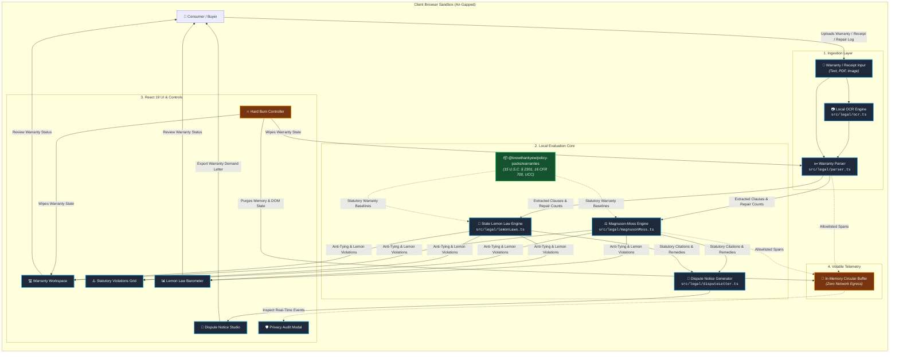
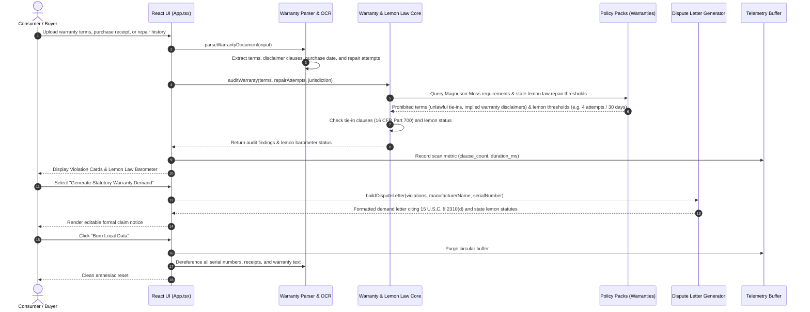

<!-- diagram-meta
  last-validated: 2026-10-26
  validated-commit: ab363e2
  covers: [src/**]
  generated-by: manual
-->

# Architecture & Invariants Specification: Warranty Watch Reality Engine

> Client-side consumer warranty auditor, Magnuson-Moss Act validator, anti-tying detector, and state lemon law dispute studio.

---

## 1. Executive Summary

`warranty-watch` is a client-side reality engine in the `knowthankyew` portfolio built to protect consumers against defective products and deceptive warranty terms. Operating under zero-egress local processing, it audits product warranty agreements, receipts, and repair histories against federal protections (Magnuson-Moss Warranty Act, 15 U.S.C. § 2301; FTC Anti-Tying Rule, 16 CFR Part 700) and state Lemon Laws (such as California Song-Beverly, New York, and Florida statutes), generating legally grounded warranty breach and refund demands.

---

## 2. System Architecture & Component Interactions

### A. Execution Sandbox & Trust Boundary



### B. Warranty Audit & Claim Notice Lifecycle



---

## 3. Core Architectural Invariants

| # | Invariant | Enforcement & Guarantee |
|:--|:----------|:------------------------|
| 1 | **Zero Document Egress** | Product receipts, serial numbers, warranty terms, and repair histories never leave the browser sandbox. |
| 2 | **Volatile Memory Telemetry** | Operational events are held strictly in an in-memory ring buffer for the local privacy modal; zero network export in consumer builds. |
| 3 | **Strict Key Allowlists** | Telemetry sanitizes properties against `SAFE_ALLOWLIST_KEYS`; product names, serial numbers, and purchase costs are redacted. |
| 4 | **Compile-Time Dead Code Shims** | Enterprise network telemetry exporter code is excised at compile time for public consumer builds. |
| 5 | **Amnesiac State Purge (Hard Burn)** | Complete memory purge removing all warranty terms, receipt scans, and OCR canvases. |

---

## 4. Directory Structure

```
warranty-watch/
├── docs/
│   ├── ARCHITECTURE.md          # Architecture, data flow & invariant specification
│   └── PRIVACY_TELEMETRY_SCHEMA.md # Telemetry contract specification
├── src/
│   ├── App.tsx                  # Root application view & workflow orchestration
│   ├── main.tsx                 # Entrypoint
│   ├── index.css                # Tailwind CSS v4 styling
│   ├── components/              # UI components (Workspace, ViolationGrid, LemonBarometer, DisputeStudio)
│   └── legal/
│       ├── parser.ts            # Warranty text & repair log parser
│       ├── magnusonMoss.ts      # Magnuson-Moss Act & FTC Anti-Tying rules
│       ├── lemonLaws.ts         # State lemon law thresholds (CA Song-Beverly, NY, etc.)
│       ├── policy-loader.ts     # Ingestion of @knowthankyew/policy-packs/warranties
│       ├── disputeLetter.ts     # Formal warranty breach / lemon claim generator
│       ├── ocr.ts               # Local OCR engine for paper warranties & receipts
│       ├── sampleWarranties.ts  # Synthetic test warranty terms
│       ├── telemetry.ts         # In-memory privacy telemetry controller
│       └── types.ts             # TypeScript domain definitions
├── tests/                       # Vitest unit test suites
└── vite.config.ts               # Air-gapped bundler configuration
```
